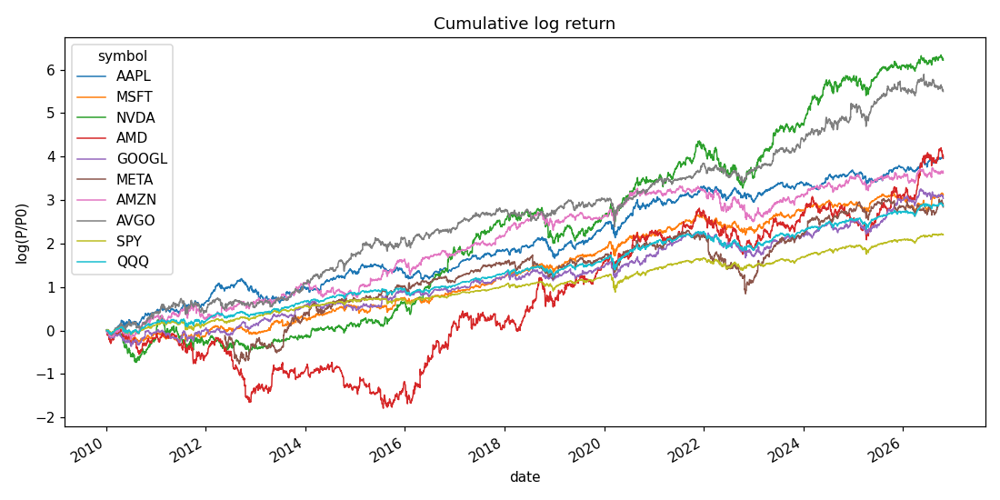
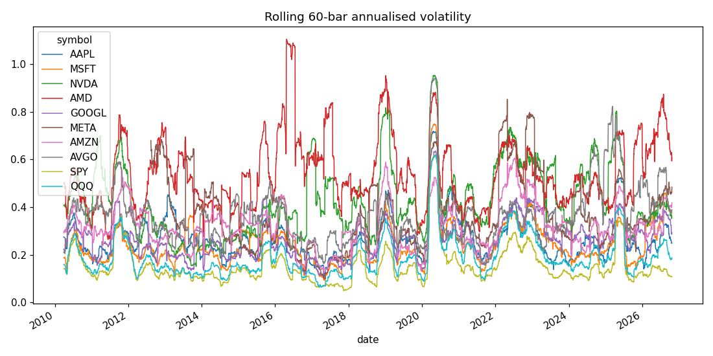
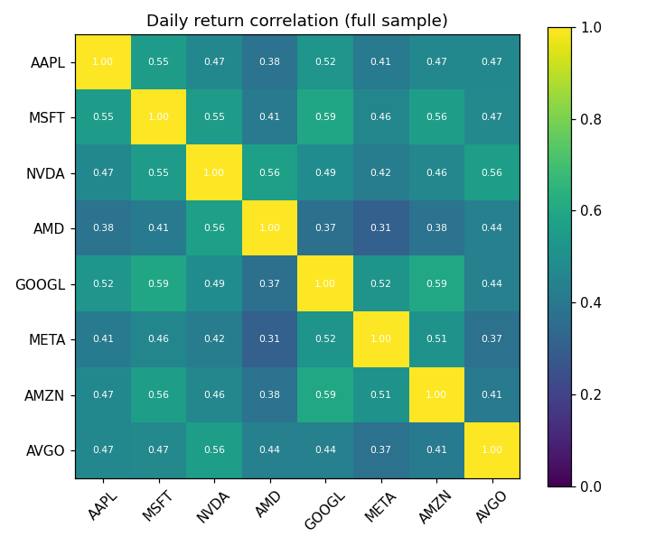
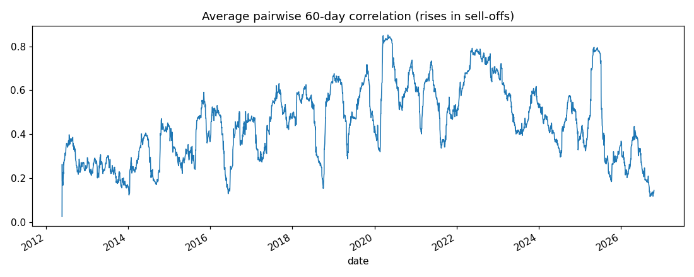
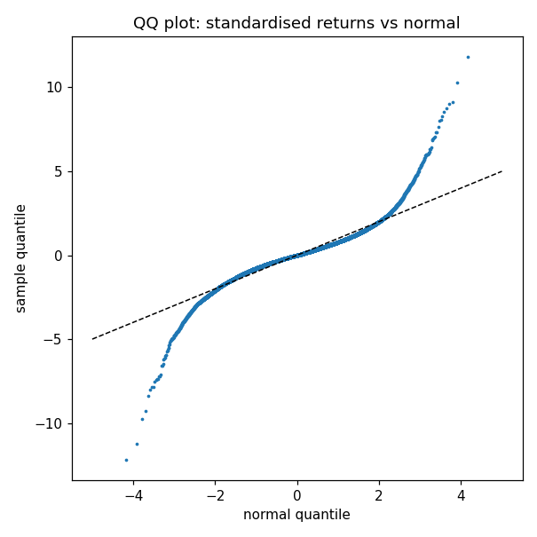

# Market analysis

Universe: AAPL, MSFT, NVDA, AMD, GOOGL, META, AMZN, AVGO. Benchmarks: SPY, QQQ. Sample 2010-01-05 – 2026-10-22 (4226 1d bars). Log returns per bar; annualised with 252 bars per year.

## Key findings

- Returns are fat-tailed: average excess kurtosis 9.0 (normal = 0); Jarque-Bera rejects normality for every series. Risk models assuming normal returns understate tail losses.
- Volatility clusters: ARCH-LM rejects constant variance for 8/8 stocks. Volatility is predictable even when returns are not - the basis for volatility targeting.
- ADF: log prices look non-stationary for 8/8 stocks, returns are stationary for 8/8, so models are fit on returns rather than prices.
- Random-walk (variance ratio) rejected at 5% for 0/8 stocks; next-day reversal (r1) significant for 2/8, 20-day momentum for 2/8. Linear predictability is weak.
- The stocks move together: mean pairwise correlation 0.47, first principal component explains 54% of variance. Diversification within the universe is limited.
- Average beta to QQQ: 1.21; average R² 0.48.

## Return distribution

|  | start | ann_ret | ann_vol | sharpe | skew | ex_kurt | jb_p | max_dd | VaR95_1bar | CVaR95_1bar |
|---|---|---|---|---|---|---|---|---|---|---|
| AAPL | 2010-01-05 | 0.238 | 0.281 | 0.849 | -0.171 | 6.049 | 0.000 | -0.438 | 0.027 | 0.041 |
| MSFT | 2010-01-05 | 0.186 | 0.260 | 0.716 | -0.027 | 8.742 | 0.000 | -0.371 | 0.025 | 0.037 |
| NVDA | 2010-01-05 | 0.371 | 0.451 | 0.823 | 0.173 | 6.768 | 0.000 | -0.663 | 0.043 | 0.063 |
| AMD | 2010-01-05 | 0.236 | 0.563 | 0.419 | 0.301 | 8.679 | 0.000 | -0.841 | 0.054 | 0.080 |
| GOOGL | 2010-01-05 | 0.181 | 0.278 | 0.652 | 0.144 | 6.804 | 0.000 | -0.443 | 0.026 | 0.040 |
| META | 2012-05-21 | 0.197 | 0.400 | 0.494 | -0.378 | 20.241 | 0.000 | -0.767 | 0.037 | 0.058 |
| AMZN | 2010-01-05 | 0.216 | 0.328 | 0.658 | 0.104 | 6.085 | 0.000 | -0.561 | 0.031 | 0.047 |
| AVGO | 2010-01-05 | 0.328 | 0.382 | 0.857 | -0.090 | 8.296 | 0.000 | -0.483 | 0.035 | 0.053 |
| SPY | 2010-01-05 | 0.131 | 0.171 | 0.770 | -0.554 | 12.427 | 0.000 | -0.337 | 0.016 | 0.026 |
| QQQ | 2010-01-05 | 0.171 | 0.207 | 0.826 | -0.377 | 7.142 | 0.000 | -0.351 | 0.021 | 0.031 |

`jb_p`: Jarque-Bera normality p-value. VaR/CVaR are 1-bar historical 95% losses.

## Stationarity, autocorrelation, volatility clustering, random walk

|  | adf_p_logprice | adf_p_returns | acf1 | ljungbox_p_r | ljungbox_p_r2 | arch_lm_p | VR(5) | z_VR5 | VR(20) | z_VR20 |
|---|---|---|---|---|---|---|---|---|---|---|
| AAPL | 0.849 | 0.000 | -0.029 | 1.31e-07 | 5.56e-190 | 1.85e-79 | 0.941 | -0.017 | 0.908 | -0.013 |
| MSFT | 0.967 | 0.000 | -0.083 | 9.83e-15 | 7.09e-211 | 6.63e-101 | 0.863 | -0.033 | 0.741 | -0.032 |
| NVDA | 0.993 | 0.000 | -0.057 | 1.70e-05 | 1.98e-44 | 1.22e-26 | 0.928 | -0.023 | 0.924 | -0.012 |
| AMD | 0.987 | 0.000 | -0.025 | 0.007 | 1.69e-08 | 5.17e-09 | 0.984 | -0.006 | 0.999 | -1.81e-04 |
| GOOGL | 0.971 | 0.000 | -0.026 | 8.75e-04 | 3.54e-32 | 3.99e-19 | 0.938 | -0.021 | 0.851 | -0.024 |
| META | 0.711 | 0.000 | -0.022 | 0.064 | 0.006 | 0.011 | 0.948 | -0.018 | 0.888 | -0.018 |
| AMZN | 0.718 | 0.000 | -0.014 | 0.225 | 5.13e-22 | 2.48e-15 | 0.949 | -0.018 | 0.842 | -0.027 |
| AVGO | 0.943 | 0.000 | -0.054 | 1.78e-06 | 3.08e-125 | 1.77e-68 | 0.906 | -0.025 | 0.740 | -0.035 |
| SPY | 0.943 | 2.95e-26 | -0.100 | 6.65e-31 | 0.000 | 1.02e-250 | 0.869 | -0.023 | 0.777 | -0.019 |
| QQQ | 0.927 | 1.25e-26 | -0.086 | 1.18e-20 | 0.000 | 3.38e-174 | 0.864 | -0.031 | 0.766 | -0.026 |

Ljung-Box on r tests return autocorrelation; on r² tests volatility clustering. VR(q) is the Lo-MacKinlay variance ratio (1 = random walk) with robust z.

## Market factor (CAPM vs QQQ, HAC t-stats)

|  | alpha_ann | alpha_t | beta | r2 | idio_vol_ann |
|---|---|---|---|---|---|
| AAPL | 0.066 | 1.400 | 1.009 | 0.552 | 0.188 |
| MSFT | 0.019 | 0.494 | 0.979 | 0.605 | 0.163 |
| NVDA | 0.104 | 1.361 | 1.563 | 0.514 | 0.314 |
| AMD | -0.035 | -0.314 | 1.587 | 0.339 | 0.457 |
| GOOGL | 0.011 | 0.251 | 0.994 | 0.546 | 0.187 |
| META | -0.012 | -0.143 | 1.173 | 0.369 | 0.318 |
| AMZN | 0.025 | 0.447 | 1.118 | 0.496 | 0.233 |
| AVGO | 0.114 | 1.706 | 1.252 | 0.457 | 0.282 |

## Time-series predictability (next-bar return on past 1 and 20 bars, HAC t-stats)

|  | b_r1 | t_r1 | b_r20 | t_r20 |
|---|---|---|---|---|
| AAPL | -0.0292 | -0.9819 | 0.0002 | 0.0590 |
| MSFT | -0.0833 | -2.0305 | -0.0117 | -2.9287 |
| NVDA | -0.0572 | -2.3721 | 0.0007 | 0.1931 |
| AMD | -0.0245 | -1.0053 | 0.0029 | 0.8095 |
| GOOGL | -0.0261 | -1.1060 | -0.0057 | -1.6267 |
| META | -0.0218 | -1.0537 | 2.06e-05 | 0.0048 |
| AMZN | -0.0139 | -0.6803 | -0.0063 | -1.5657 |
| AVGO | -0.0544 | -1.8001 | -0.0118 | -2.8220 |

## Day-of-week effect (pooled)

| weekday | mean_bps | t | n |
|---|---|---|---|
| Monday | 14.23 | 4.79 | 6211.00 |
| Tuesday | 11.05 | 4.27 | 6836.00 |
| Wednesday | 17.80 | 6.22 | 6812.00 |
| Thursday | 4.94 | 1.58 | 6694.00 |
| Friday | 0.70 | 0.22 | 6656.00 |

## Correlation

| symbol | AAPL | MSFT | NVDA | AMD | GOOGL | META | AMZN | AVGO |
|---|---|---|---|---|---|---|---|---|
| AAPL | 1.00 | 0.55 | 0.47 | 0.38 | 0.52 | 0.41 | 0.47 | 0.47 |
| MSFT | 0.55 | 1.00 | 0.55 | 0.41 | 0.59 | 0.46 | 0.56 | 0.47 |
| NVDA | 0.47 | 0.55 | 1.00 | 0.56 | 0.49 | 0.42 | 0.46 | 0.56 |
| AMD | 0.38 | 0.41 | 0.56 | 1.00 | 0.37 | 0.31 | 0.38 | 0.44 |
| GOOGL | 0.52 | 0.59 | 0.49 | 0.37 | 1.00 | 0.52 | 0.59 | 0.44 |
| META | 0.41 | 0.46 | 0.42 | 0.31 | 0.52 | 1.00 | 0.51 | 0.37 |
| AMZN | 0.47 | 0.56 | 0.46 | 0.38 | 0.59 | 0.51 | 1.00 | 0.41 |
| AVGO | 0.47 | 0.47 | 0.56 | 0.44 | 0.44 | 0.37 | 0.41 | 1.00 |

Last 252 days:

| symbol | AAPL | MSFT | NVDA | AMD | GOOGL | META | AMZN | AVGO |
|---|---|---|---|---|---|---|---|---|
| AAPL | 1.00 | 0.12 | 0.07 | 0.04 | 0.13 | 0.11 | 0.06 | 0.12 |
| MSFT | 0.12 | 1.00 | 0.26 | 0.14 | 0.17 | 0.19 | 0.40 | 0.21 |
| NVDA | 0.07 | 0.26 | 1.00 | 0.52 | 0.25 | 0.30 | 0.27 | 0.53 |
| AMD | 0.04 | 0.14 | 0.52 | 1.00 | 0.23 | 0.23 | 0.25 | 0.53 |
| GOOGL | 0.13 | 0.17 | 0.25 | 0.23 | 1.00 | 0.30 | 0.56 | 0.29 |
| META | 0.11 | 0.19 | 0.30 | 0.23 | 0.30 | 1.00 | 0.39 | 0.20 |
| AMZN | 0.06 | 0.40 | 0.27 | 0.25 | 0.56 | 0.39 | 1.00 | 0.25 |
| AVGO | 0.12 | 0.21 | 0.53 | 0.53 | 0.29 | 0.20 | 0.25 | 1.00 |

Principal component variance shares: 54.1%, 10.9%, 7.8%, 6.8%

## Figures

