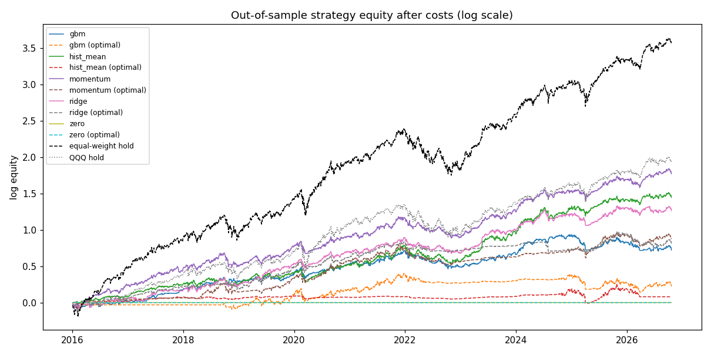

# Out-of-sample evaluation

1d bars. Walk-forward from 2016-01-01, retraining every 12 month(s). Target: 1-bar forward log return, execution at `next_open`. 21720 common out-of-sample predictions per model.

## Conclusion

- No transformer predictions found - run `python -m trader walkforward --models transformer`.

## Forecast quality

|  | n | mse_e4 | r2_oos | hit_rate | auc | brier | logloss | ic_mean | ic_t | ts_corr | dm_vs_zero | dm_p | dm_vs_histmean |
|---|---|---|---|---|---|---|---|---|---|---|---|---|---|
| gbm | 21720.0000 | 6.3043 | -0.0106 | 0.5166 | 0.4986 | 0.2523 | 0.6979 | 0.0223 | 2.7904 | 0.0262 | 1.5202 | 0.1285 | 1.7874 |
| hist_mean | 21720.0000 | 6.2302 | 0.0013 | 0.5369 | 0.4940 | 0.2490 | 0.6912 | -0.0031 | -0.4110 | -0.0298 | -1.2101 | 0.2262 | 0.0000 |
| momentum | 21720.0000 | 6.2234 | 0.0024 | 0.5383 | 0.5096 | 0.2487 | 0.6906 | 0.0173 | 2.2163 | 0.0270 | -0.9359 | 0.3493 | -0.5778 |
| ridge | 21720.0000 | 6.2476 | -0.0015 | 0.5274 | 0.5042 | 0.2497 | 0.6925 | 0.0263 | 3.2687 | 0.0264 | 0.4205 | 0.6741 | 0.8286 |
| zero | 21720.0000 | 6.2381 | 0.0000 | – | 0.4803 | 0.2489 | 0.6909 | – | – | – | 0.0000 | 1.0000 | 1.2101 |

`r2_oos` vs predicting 0; `ic_mean` = mean daily cross-sectional Spearman correlation, `ic_t` its Newey-West t-stat; `ts_corr` = average per-stock time-series correlation; `dm_*` = Diebold-Mariano statistic on squared errors (negative = better than the reference).

## Trading simulation (after costs)

|  | cagr | ann_vol | sharpe | sharpe_lo95 | sharpe_hi95 | psr | sortino | max_dd | calmar | worst_day | hit_days | turnover_ann | cost_drag_ann | avg_gross | days_halted |
|---|---|---|---|---|---|---|---|---|---|---|---|---|---|---|---|
| gbm | 0.069 | 0.130 | 0.582 | 0.105 | 1.234 | 0.970 | 0.680 | -0.222 | 0.312 | -0.076 | 0.477 | 86.458 | 0.043 | 0.397 | 47.000 |
| gbm (optimal) | 0.021 | 0.111 | 0.241 | -0.236 | 0.878 | 0.784 | 0.233 | -0.223 | 0.093 | -0.079 | 0.510 | 50.315 | 0.025 | 0.289 | 42.000 |
| hist_mean | 0.144 | 0.143 | 1.010 | 0.477 | 1.645 | 0.999 | 1.347 | -0.232 | 0.618 | -0.051 | 0.555 | 2.016 | 0.001 | 0.488 | 45.000 |
| hist_mean (optimal) | 0.007 | 0.066 | 0.145 | -0.453 | 0.697 | 0.681 | 0.139 | -0.180 | 0.041 | -0.043 | 0.537 | 1.143 | 5.72e-04 | 0.158 | 27.000 |
| momentum | 0.178 | 0.155 | 1.137 | 0.636 | 1.815 | 1.000 | 1.482 | -0.255 | 0.699 | -0.059 | 0.556 | 31.482 | 0.016 | 0.528 | 63.000 |
| momentum (optimal) | 0.084 | 0.119 | 0.744 | 0.251 | 1.399 | 0.992 | 0.851 | -0.248 | 0.341 | -0.060 | 0.549 | 19.409 | 0.010 | 0.316 | 45.000 |
| ridge | 0.124 | 0.137 | 0.926 | 0.423 | 1.630 | 0.999 | 1.193 | -0.199 | 0.626 | -0.054 | 0.516 | 64.216 | 0.032 | 0.456 | 32.000 |
| ridge (optimal) | 0.078 | 0.104 | 0.776 | 0.210 | 1.488 | 0.994 | 0.879 | -0.193 | 0.406 | -0.063 | 0.551 | 32.933 | 0.016 | 0.326 | 19.000 |
| zero | 0.000 | 0.000 | 0.000 | 0.000 | 0.000 | – | – | 0.000 | – | 0.000 | – | 0.000 | 0.000 | 0.000 | 0.000 |
| zero (optimal) | 0.000 | 0.000 | 0.000 | 0.000 | 0.000 | – | – | 0.000 | – | 0.000 | – | 0.000 | 0.000 | 0.000 | 0.000 |
| equal_weight_hold | 0.390 | 0.289 | 1.283 | 0.773 | 2.004 | 1.000 | 1.724 | -0.473 | 0.825 | -0.089 | 0.567 | – | – | – | – |
| QQQ_hold | 0.196 | 0.217 | 0.934 | 0.433 | 1.627 | 0.999 | 1.195 | -0.367 | 0.534 | -0.087 | 0.565 | – | – | – | – |

Strategy: long-only, P(up) ≥ 0.52, target vol 15%, max 20% per stock, gross ≤ 100%, daily loss limit 3%, drawdown stop 15%. Costs 5.0 bps per side. Benchmarks ignore costs. Rows marked (optimal) use the OptimalTrader (risk aversion 2.0, holding period 5, calibrated on the last 500 periods of each model's own track record) under the same limits.

## Sharpe ratio by year

| date | gbm | gbm (optimal) | hist_mean | hist_mean (optimal) | momentum | momentum (optimal) | ridge | ridge (optimal) | zero | zero (optimal) | equal_weight_hold |
|---|---|---|---|---|---|---|---|---|---|---|---|
| 2016 | 0.23 | -0.67 | 0.85 | 0.27 | 1.84 | 1.39 | 0.53 | 0.82 | 0.00 | 0.00 | 2.19 |
| 2017 | 2.28 | 0.00 | 2.43 | 2.07 | 1.80 | 2.38 | 1.38 | 2.83 | 0.00 | 0.00 | 2.25 |
| 2018 | 0.86 | -0.22 | 0.10 | -0.47 | 0.32 | 0.63 | 0.46 | -0.31 | 0.00 | 0.00 | 0.28 |
| 2019 | 1.03 | 1.34 | 1.46 | 1.62 | 2.21 | 2.35 | 2.66 | 2.30 | 0.00 | 0.00 | 2.51 |
| 2020 | 0.87 | 0.40 | 0.73 | -0.65 | 0.75 | 1.36 | 1.13 | 0.91 | 0.00 | 0.00 | 1.48 |
| 2021 | 1.50 | 1.64 | 1.86 | 0.81 | 1.85 | 1.32 | 1.69 | 2.29 | 0.00 | 0.00 | 2.15 |
| 2022 | -1.49 | -1.13 | -1.28 | -1.68 | -1.63 | -1.27 | -1.31 | -1.09 | 0.00 | 0.00 | -1.10 |
| 2023 | 1.63 | 1.45 | 2.59 | 2.37 | 2.62 | 2.59 | 2.40 | 2.64 | 0.00 | 0.00 | 2.80 |
| 2024 | 2.10 | 1.09 | 2.12 | 1.12 | 1.92 | 1.71 | 1.62 | -0.61 | 0.00 | 0.00 | 1.91 |
| 2025 | -0.46 | -0.52 | 0.81 | 0.24 | 1.06 | 1.34 | 0.73 | 1.72 | 0.00 | 0.00 | 1.14 |
| 2026 | -1.00 | -0.36 | 0.32 | -1.56 | 0.69 | -0.36 | -0.31 | -1.09 | 0.00 | 0.00 | 1.18 |

## Figures

