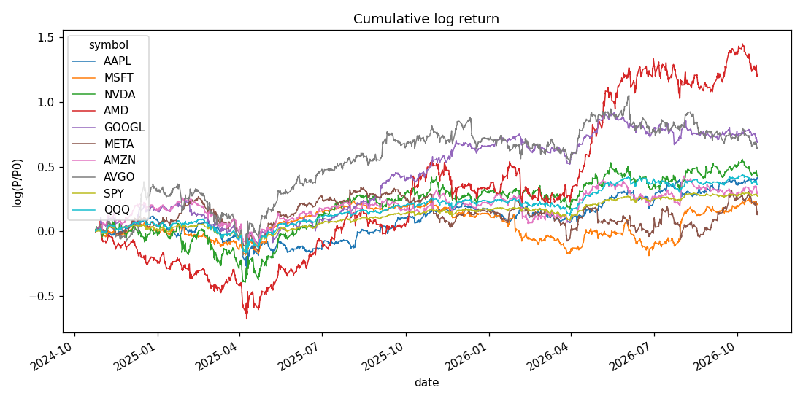
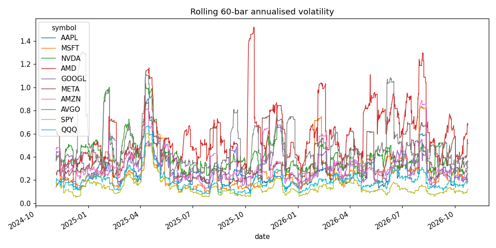
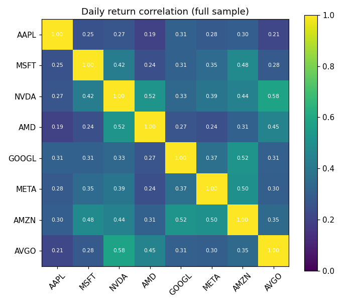
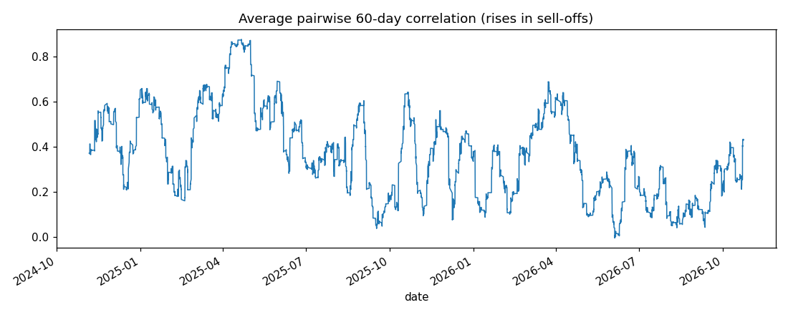
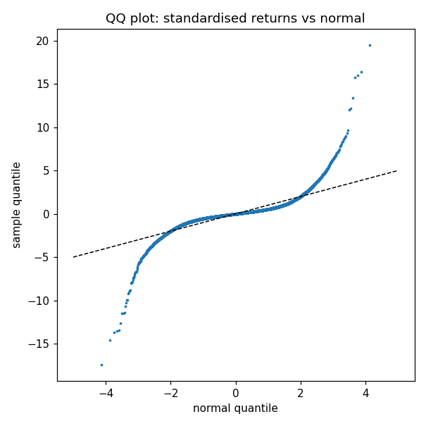

# Market analysis

Universe: AAPL, MSFT, NVDA, AMD, GOOGL, META, AMZN, AVGO. Benchmarks: SPY, QQQ. Sample 2024-10-24 – 2026-10-23 (3482 1h bars). Log returns per bar; annualised with 1764 bars per year.

## Key findings

- Returns are fat-tailed: average excess kurtosis 38.2 (normal = 0); Jarque-Bera rejects normality for every series. Risk models assuming normal returns understate tail losses.
- Volatility clusters: ARCH-LM rejects constant variance for 1/8 stocks. Volatility is predictable even when returns are not - the basis for volatility targeting.
- ADF: log prices look non-stationary for 7/8 stocks, returns are stationary for 8/8, so models are fit on returns rather than prices.
- Random-walk (variance ratio) rejected at 5% for 0/8 stocks; next-bar reversal (r1) significant for 0/8, 20-bar momentum for 0/8. Linear predictability is weak.
- The stocks move together: mean pairwise correlation 0.35, first principal component explains 44% of variance. Diversification within the universe is limited.
- Average beta to QQQ: 1.20; average R² 0.37.

## Return distribution

|  | start | ann_ret | ann_vol | sharpe | skew | ex_kurt | jb_p | max_dd | VaR95_1bar | CVaR95_1bar |
|---|---|---|---|---|---|---|---|---|---|---|
| AAPL | 2024-10-24 | 0.209 | 0.281 | 0.741 | -1.379 | 29.839 | 0.000 | -0.333 | 0.008 | 0.016 |
| MSFT | 2024-10-24 | 0.107 | 0.294 | 0.364 | 1.072 | 85.053 | 0.000 | -0.356 | 0.008 | 0.015 |
| NVDA | 2024-10-24 | 0.215 | 0.433 | 0.497 | -0.673 | 17.233 | 0.000 | -0.384 | 0.015 | 0.026 |
| AMD | 2024-10-24 | 0.616 | 0.633 | 0.973 | 1.564 | 36.260 | 0.000 | -0.531 | 0.017 | 0.034 |
| GOOGL | 2024-10-24 | 0.349 | 0.331 | 1.055 | 0.056 | 19.955 | 0.000 | -0.301 | 0.010 | 0.018 |
| META | 2024-10-24 | 0.066 | 0.393 | 0.167 | -0.421 | 34.978 | 0.000 | -0.347 | 0.011 | 0.022 |
| AMZN | 2024-10-24 | 0.148 | 0.349 | 0.425 | 1.629 | 40.962 | 0.000 | -0.317 | 0.010 | 0.019 |
| AVGO | 2024-10-24 | 0.326 | 0.513 | 0.636 | 0.228 | 41.139 | 0.000 | -0.434 | 0.015 | 0.028 |
| SPY | 2024-10-24 | 0.139 | 0.159 | 0.876 | 0.224 | 24.814 | 0.000 | -0.194 | 0.005 | 0.009 |
| QQQ | 2024-10-24 | 0.185 | 0.210 | 0.881 | 0.229 | 14.375 | 0.000 | -0.232 | 0.007 | 0.012 |

`jb_p`: Jarque-Bera normality p-value. VaR/CVaR are 1-bar historical 95% losses.

## Stationarity, autocorrelation, volatility clustering, random walk

|  | adf_p_logprice | adf_p_returns | acf1 | ljungbox_p_r | ljungbox_p_r2 | arch_lm_p | VR(5) | z_VR5 | VR(20) | z_VR20 |
|---|---|---|---|---|---|---|---|---|---|---|
| AAPL | 0.854 | 3.60e-25 | 0.025 | 0.136 | 1.16e-23 | 0.101 | 1.045 | 0.016 | 1.174 | 0.024 |
| MSFT | 0.497 | 0.000 | 0.003 | 0.830 | 0.967 | 0.986 | 1.020 | 0.008 | 1.021 | 0.004 |
| NVDA | 0.605 | 0.000 | -0.019 | 0.230 | 1.36e-15 | 0.024 | 0.984 | -0.006 | 0.966 | -0.006 |
| AMD | 0.952 | 0.000 | -0.008 | 0.372 | 1.02e-04 | 0.966 | 0.961 | -0.018 | 0.934 | -0.013 |
| GOOGL | 0.718 | 0.000 | -0.013 | 0.021 | 5.02e-08 | 0.504 | 0.963 | -0.015 | 0.973 | -0.005 |
| META | 0.044 | 0.000 | 0.010 | 0.525 | 0.113 | 0.984 | 1.021 | 0.009 | 0.963 | -0.007 |
| AMZN | 0.088 | 0.000 | -0.012 | 3.66e-07 | 5.95e-29 | 0.992 | 0.951 | -0.020 | 0.950 | -0.008 |
| AVGO | 0.317 | 0.000 | -0.005 | 0.409 | 4.04e-11 | 0.930 | 0.987 | -0.005 | 1.024 | 0.004 |
| SPY | 0.840 | 1.54e-22 | 0.003 | 0.002 | 4.10e-164 | 1.13e-27 | 0.981 | -0.004 | 0.929 | -0.007 |
| QQQ | 0.722 | 4.70e-30 | 0.003 | 0.061 | 3.24e-105 | 3.03e-20 | 0.996 | -0.001 | 0.953 | -0.006 |

Ljung-Box on r tests return autocorrelation; on r² tests volatility clustering. VR(q) is the Lo-MacKinlay variance ratio (1 = random walk) with robust z.

## Market factor (CAPM vs QQQ, HAC t-stats)

|  | alpha_ann | alpha_t | beta | r2 | idio_vol_ann |
|---|---|---|---|---|---|
| AAPL | 0.089 | 0.493 | 0.645 | 0.230 | 0.247 |
| MSFT | -0.031 | -0.170 | 0.746 | 0.282 | 0.249 |
| NVDA | -0.074 | -0.363 | 1.565 | 0.573 | 0.283 |
| AMD | 0.246 | 0.770 | 2.006 | 0.441 | 0.473 |
| GOOGL | 0.189 | 0.989 | 0.866 | 0.301 | 0.277 |
| META | -0.122 | -0.523 | 1.014 | 0.292 | 0.331 |
| AMZN | -0.051 | -0.276 | 1.081 | 0.421 | 0.266 |
| AVGO | 0.023 | 0.083 | 1.643 | 0.451 | 0.380 |

## Time-series predictability (next-bar return on past 1 and 20 bars, HAC t-stats)

|  | b_r1 | t_r1 | b_r20 | t_r20 |
|---|---|---|---|---|
| AAPL | 0.0248 | 1.3396 | 0.0026 | 0.5331 |
| MSFT | 0.0032 | 0.1408 | 0.0007 | 0.1494 |
| NVDA | -0.0194 | -0.8266 | -0.0003 | -0.1007 |
| AMD | -0.0076 | -0.3963 | -0.0013 | -0.3449 |
| GOOGL | -0.0129 | -0.6405 | -0.0015 | -0.4535 |
| META | 0.0099 | 0.4880 | -0.0026 | -0.8171 |
| AMZN | -0.0122 | -0.6065 | -0.0023 | -0.5951 |
| AVGO | -0.0051 | -0.2590 | 0.0003 | 0.0684 |

## Day-of-week effect (pooled)

| weekday | mean_bps | t | n |
|---|---|---|---|
| Monday | 5.17 | 3.70 | 5376.00 |
| Tuesday | 1.23 | 1.05 | 5792.00 |
| Wednesday | 5.46 | 4.01 | 5680.00 |
| Thursday | -4.13 | -2.87 | 5504.00 |
| Friday | -0.53 | -0.41 | 5504.00 |

## Time-of-day effect (pooled, bar start time)

| bar | mean_bps | t | vol_bps | abs_move_bps | n |
|---|---|---|---|---|---|
| 09:30 | 7.49 | 2.13 | 222.09 | 147.73 | 4000.00 |
| 10:30 | 0.33 | 0.28 | 73.55 | 52.38 | 4008.00 |
| 11:30 | 2.11 | 2.23 | 59.84 | 41.91 | 4008.00 |
| 12:30 | -0.36 | -0.39 | 58.94 | 37.56 | 3960.00 |
| 13:30 | 1.44 | 1.71 | 52.99 | 34.47 | 3960.00 |
| 14:30 | -2.46 | -3.24 | 47.78 | 33.08 | 3960.00 |
| 15:30 | 1.49 | 1.92 | 48.87 | 33.91 | 3960.00 |

The first bar includes the overnight gap, so it is far more volatile than the rest of the day.

## Correlation

| symbol | AAPL | MSFT | NVDA | AMD | GOOGL | META | AMZN | AVGO |
|---|---|---|---|---|---|---|---|---|
| AAPL | 1.00 | 0.25 | 0.27 | 0.19 | 0.31 | 0.28 | 0.30 | 0.21 |
| MSFT | 0.25 | 1.00 | 0.42 | 0.24 | 0.31 | 0.35 | 0.48 | 0.28 |
| NVDA | 0.27 | 0.42 | 1.00 | 0.52 | 0.33 | 0.39 | 0.44 | 0.58 |
| AMD | 0.19 | 0.24 | 0.52 | 1.00 | 0.27 | 0.24 | 0.31 | 0.45 |
| GOOGL | 0.31 | 0.31 | 0.33 | 0.27 | 1.00 | 0.37 | 0.52 | 0.31 |
| META | 0.28 | 0.35 | 0.39 | 0.24 | 0.37 | 1.00 | 0.50 | 0.30 |
| AMZN | 0.30 | 0.48 | 0.44 | 0.31 | 0.52 | 0.50 | 1.00 | 0.35 |
| AVGO | 0.21 | 0.28 | 0.58 | 0.45 | 0.31 | 0.30 | 0.35 | 1.00 |

Last 252 days:

| symbol | AAPL | MSFT | NVDA | AMD | GOOGL | META | AMZN | AVGO |
|---|---|---|---|---|---|---|---|---|
| AAPL | 1.00 | 0.32 | 0.05 | -0.08 | 0.43 | 0.11 | 0.27 | -0.13 |
| MSFT | 0.32 | 1.00 | 0.23 | 0.06 | 0.45 | 0.21 | 0.52 | 0.08 |
| NVDA | 0.05 | 0.23 | 1.00 | 0.61 | 0.21 | 0.12 | 0.51 | 0.52 |
| AMD | -0.08 | 0.06 | 0.61 | 1.00 | 0.16 | 0.39 | 0.43 | 0.61 |
| GOOGL | 0.43 | 0.45 | 0.21 | 0.16 | 1.00 | 0.23 | 0.64 | 0.17 |
| META | 0.11 | 0.21 | 0.12 | 0.39 | 0.23 | 1.00 | 0.23 | 2.14e-03 |
| AMZN | 0.27 | 0.52 | 0.51 | 0.43 | 0.64 | 0.23 | 1.00 | 0.50 |
| AVGO | -0.13 | 0.08 | 0.52 | 0.61 | 0.17 | 2.14e-03 | 0.50 | 1.00 |

Principal component variance shares: 43.6%, 13.3%, 9.9%, 8.7%

## Figures

