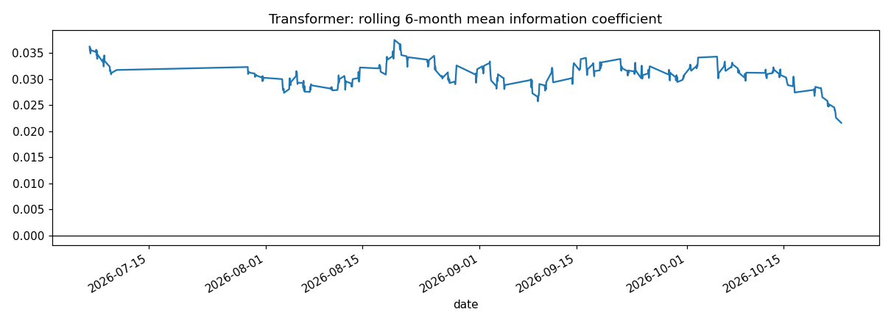

# Out-of-sample evaluation

1h bars. Walk-forward from 2025-10-24, retraining every 1 month(s). Target: 1-bar forward log return, execution at `next_open`. 9025 common out-of-sample predictions per model.

## Conclusion

- Forecast skill: transformer IC 0.0201 (t = 1.62), hit rate 0.507, AUC 0.510, out-of-sample R² -0.0012. Best baseline by IC: ridge (0.0275).
- The transformer's forecasts are NOT statistically distinguishable from noise (IC t-stat below 2 and no significant MSE improvement over predicting zero).
- It does not beat every baseline on rank correlation (IC).
- Trading after costs (transformer): Sharpe 2.03 (95% CI -0.23 to 4.12, P(Sharpe>0) = 0.97), CAGR 17.4%, max drawdown -4.0%, cost drag 0.60%/yr. Equal-weight buy & hold Sharpe: 1.25.
- VERDICT: the strategy is profitable in backtest but does not clearly beat simply holding the stocks risk-adjusted, or the forecast edge is not significant. Profit likely comes from market exposure (beta) rather than prediction. Not a reliable signal.
- Caveat: every extra model or setting tried raises the chance that a good backtest is luck (multiple testing). Treat a single favourable result with suspicion.

## Forecast quality

|  | n | mse_e4 | r2_oos | hit_rate | auc | brier | logloss | ic_mean | ic_t | ts_corr | dm_vs_zero | dm_p | dm_vs_histmean |
|---|---|---|---|---|---|---|---|---|---|---|---|---|---|
| gbm | 9025.0000 | 1.0251 | -0.0097 | 0.5017 | 0.4975 | 0.2530 | 0.6993 | 0.0141 | 1.1492 | 0.0133 | 2.1738 | 0.0297 | 2.3040 |
| hist_mean | 9025.0000 | 1.0152 | 0.0001 | 0.5024 | 0.5027 | 0.2500 | 0.6932 | -0.0020 | -0.1595 | -0.0492 | -0.0974 | 0.9224 | 0.0000 |
| momentum | 9025.0000 | 1.0153 | -1.91e-05 | 0.5046 | 0.5064 | 0.2500 | 0.6931 | 0.0137 | 1.0983 | 0.0159 | -0.3347 | 0.7378 | -0.3032 |
| ridge | 9025.0000 | 1.0181 | -0.0028 | 0.5044 | 0.5112 | 0.2503 | 0.6938 | 0.0275 | 2.2030 | 0.0078 | 0.5837 | 0.5594 | 0.6405 |
| transformer | 9025.0000 | 1.0165 | -0.0012 | 0.5069 | 0.5103 | 0.2501 | 0.6934 | 0.0201 | 1.6187 | 0.0231 | 0.6538 | 0.5132 | 0.7614 |
| zero | 9025.0000 | 1.0153 | 0.0000 | – | 0.4799 | 0.2500 | 0.6931 | – | – | – | 0.0000 | 1.0000 | 0.0974 |

`r2_oos` vs predicting 0; `ic_mean` = mean daily cross-sectional Spearman correlation, `ic_t` its Newey-West t-stat; `ts_corr` = average per-stock time-series correlation; `dm_*` = Diebold-Mariano statistic on squared errors (negative = better than the reference).

## Trading simulation (after costs)

|  | cagr | ann_vol | sharpe | sharpe_lo95 | sharpe_hi95 | psr | sortino | max_dd | calmar | worst_day | hit_days | turnover_ann | cost_drag_ann | avg_gross | days_halted |
|---|---|---|---|---|---|---|---|---|---|---|---|---|---|---|---|
| gbm | -0.051 | 0.097 | -0.493 | -2.354 | 1.416 | 0.314 | -0.455 | -0.105 | -0.489 | -0.017 | 0.374 | 265.797 | 0.133 | 0.144 | 0.000 |
| gbm (optimal) | 0.017 | 0.116 | 0.202 | -2.058 | 2.495 | 0.578 | 0.197 | -0.125 | 0.134 | -0.032 | 0.490 | 91.434 | 0.046 | 0.370 | 2.000 |
| hist_mean | 0.000 | 0.000 | 0.000 | 0.000 | 0.000 | – | – | 0.000 | – | 0.000 | – | 0.000 | 0.000 | 0.000 | 0.000 |
| hist_mean (optimal) | 0.003 | 0.056 | 0.089 | -1.469 | 1.518 | 0.535 | 0.066 | -0.047 | 0.072 | -0.012 | 0.511 | 1.070 | 5.35e-04 | 0.079 | 0.000 |
| momentum | 0.027 | 0.063 | 0.462 | -1.251 | 2.165 | 0.674 | 0.322 | -0.039 | 0.705 | -0.015 | 0.461 | 22.121 | 0.011 | 0.054 | 0.000 |
| momentum (optimal) | 0.033 | 0.067 | 0.524 | -1.119 | 2.516 | 0.694 | 0.338 | -0.065 | 0.516 | -0.020 | 0.510 | 20.507 | 0.010 | 0.131 | 0.000 |
| ridge | 0.096 | 0.088 | 1.087 | -0.594 | 2.958 | 0.861 | 0.920 | -0.055 | 1.743 | -0.021 | 0.439 | 63.627 | 0.032 | 0.080 | 1.000 |
| ridge (optimal) | 0.081 | 0.085 | 0.960 | -1.167 | 3.183 | 0.828 | 0.918 | -0.067 | 1.217 | -0.022 | 0.512 | 23.352 | 0.012 | 0.144 | 1.000 |
| transformer | 0.174 | 0.081 | 2.025 | -0.225 | 4.124 | 0.971 | 1.798 | -0.040 | 4.380 | -0.015 | 0.537 | 11.952 | 0.006 | 0.124 | 0.000 |
| transformer (optimal) | 0.096 | 0.120 | 0.821 | -1.295 | 3.239 | 0.770 | 0.958 | -0.102 | 0.935 | -0.026 | 0.506 | 13.643 | 0.007 | 0.339 | 3.000 |
| zero | 0.000 | 0.000 | 0.000 | 0.000 | 0.000 | – | – | 0.000 | – | 0.000 | – | 0.000 | 0.000 | 0.000 | 0.000 |
| zero (optimal) | 0.000 | 0.000 | 0.000 | 0.000 | 0.000 | – | – | 0.000 | – | 0.000 | – | 0.000 | 0.000 | 0.000 | 0.000 |
| equal_weight_hold | 0.309 | 0.239 | 1.247 | -0.830 | 3.455 | 0.889 | 1.671 | -0.130 | 2.374 | -0.025 | 0.530 | – | – | – | – |
| QQQ_hold | 0.202 | 0.197 | 1.031 | -0.820 | 2.982 | 0.844 | 1.336 | -0.108 | 1.870 | -0.027 | 0.534 | – | – | – | – |

Strategy: long-only, P(up) ≥ 0.52, target vol 15%, max 20% per stock, gross ≤ 100%, daily loss limit 2%, drawdown stop 15%. Costs 5.0 bps per side. Benchmarks ignore costs. Rows marked (optimal) use the OptimalTrader (risk aversion 2.0, holding period 5, calibrated on the last 500 periods of each model's own track record) under the same limits.

## Sharpe ratio by year

| date | gbm | gbm (optimal) | hist_mean | hist_mean (optimal) | momentum | momentum (optimal) | ridge | ridge (optimal) | transformer | transformer (optimal) | zero | zero (optimal) | equal_weight_hold |
|---|---|---|---|---|---|---|---|---|---|---|---|---|---|
| 2025 | -1.02 | -3.38 | 0.00 | 0.28 | -1.41 | 3.95 | 0.51 | 4.90 | -0.45 | -1.16 | 0.00 | 0.00 | 0.20 |
| 2026 | -0.36 | 0.68 | 0.00 | -0.05 | 0.87 | -0.33 | 1.23 | 0.67 | 3.01 | 1.28 | 0.00 | 0.00 | 1.51 |

## Figures

